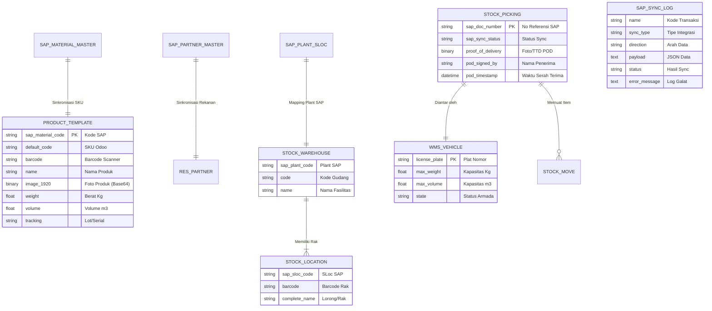

# System Specification Document (TSD) - Odoo WMS & Logistics Execution

| Field              | Value                                         |
|--------------------|-----------------------------------------------|
| **Document ID**    | ODOO-WMS-SAP-TSD-01                           |
| **Version**        | 1.0                                           |
| **Status**         | Active                                        |
| **Effective Date** | 2026-10-23                                    |
| **Authors**        | Gilang Khrismahaq                             |

**Tujuan Dokumen:**
Dokumen ini merupakan Single Source of Truth (SSOT) yang merincikan spesifikasi teknis dan fungsional dari sistem Odoo 17 Warehouse Management System (WMS) dan Logistik Pengantaran yang terintegrasi dengan SAP Upper Line (`wms_sap_connector`). Dokumen ini menjadi rujukan utama bagi penyusunan roadmap dan pelaksanaan metode *Spec-Driven Development*.

---

## Bagian 1: Kebutuhan Bisnis

### 1.1 Ringkasan Eksekutif
Proyek ini mengimplementasikan pola arsitektur *Two-Tier ERP*:
- **SAP (Upper Line / Strategic Tier):** Berperan sebagai pusat kendali keuangan, legalitas, kepatuhan audit, master data korporat, dan perencanaan pesanan pembelian/penjualan.
- **Odoo 17 (Bottom Line / Operational Tier):** Berperan sebagai sistem eksekusi pergudangan (*Warehouse Management System*) dan logistik pengantaran fisik di lapangan.

Melalui integrasi ini, pekerja lapangan (staf gudang dan supir) dapat bekerja dengan antarmuka Odoo yang lincah, mendukung barcode scanner, dan berbiaya lisensi terjangkau, sementara data transaksi fisik tetap tersinkronisasi dua arah secara *real-time* ke sistem SAP kantor pusat.

### 1.2 Tujuan Bisnis
- Mengeliminasi kebutuhan lisensi pengguna SAP yang mahal bagi operator lapangan dan supir.
- Meningkatkan akurasi stok fisik hingga level rak (*Bin Location*) dan nomor *Batch/Lot*.
- Mengurangi kesalahan pengiriman barang melalui proses validasi *barcode scanning* saat *picking* dan *packing*.
- Menyediakan pelacakan pengantaran dan bukti serah terima digital (*Proof of Delivery / POD*).
- Menghilangkan proses input manual ganda (*double-entry*) antara staf operasional dan staf akuntansi pusat melalui otomasi integrasi API.

### 1.3 Ruang Lingkup
- Sinkronisasi master data (Produk/SKU, Mitra Bisnis/Vendor/Customer, dan Lokasi Gudang/Rak).
- Alur Inbound: Penerimaan barang pesanan pembelian (*Purchase Order*), pemeriksaan kualitas di docking, dan alokasi rak simpan (*Putaway*).
- Manajemen Internal WMS: Pengelolaan rak lorong (*Bin*), pelacakan nomor *Lot/Batch*, dan pencatatan barang rusak (*Scrap*).
- Alur Outbound & Logistik: Pengambilan barang dari rak (*Picking*), pengepakan (*Packing*), pencetakan Surat Jalan resmi, penugasan armada dan supir (*Dispatching*).
- Konfirmasi Pengantaran: Pencatatan bukti terima (*Proof of Delivery*) berupa foto/tanda tangan digital.
- Modul Integrasi & Audit: Penyediaan REST API endpoint, pengiriman webhook status transaksi, serta dashboard log sinkronisasi (`sap.sync.log`).

---

## Bagian 2: Spesifikasi Fungsional

### 2.1 Profil Pengguna
- **Kepala Gudang (Warehouse Manager):** Mengelola konfigurasi tata letak gudang (*layout* lorong & rak), memantau ketersediaan stok fisik, dan mengawasi log integrasi SAP.
- **Staf Gudang (Picker / Packer):** Memindai barcode barang datang, menempatkan barang di rak (*Putaway*), dan mengambil barang pesanan (*Picking & Packing*).
- **Staf Logistik (Dispatcher):** Mengatur penugasan armada truk, menetapkan supir, dan mencetak dokumen Surat Jalan resmi.
- **Supir / Kurir (Driver):** Mengantarkan barang ke lokasi pelanggan dan mengunggah bukti tanda tangan/foto penerima (*Proof of Delivery*).
- **SAP Integration Service (System User):** Akun otomatis yang mengirimkan data transaksi (PO, Sales Delivery) dan menerima pembaruan status fisik dari Odoo.

### 2.2 Alur Proses Bisnis

#### 2.2.1 Sinkronisasi Master Data
1. SAP mengirimkan data master terbaru (Material, Vendor, Customer) melalui REST API ke Odoo.
2. Odoo memvalidasi kecocokan kode referensi SAP (`sap_material_code`, `sap_partner_code`).
3. Sistem memperbarui atau membuat record terkait di Odoo secara otomatis tanpa mengganggu data finansial bawaan Odoo, termasuk memetakan gambar visual produk (Base64) ke field bawaan Odoo.

#### 2.2.2 Alur Barang Masuk (Inbound & Putaway)
1. SAP merilis dokumen *Purchase Order* (PO) dan mengirimkan notifikasinya ke Odoo via REST API.
2. Odoo secara otomatis menerbitkan dokumen penerimaan (*Stock Receipt*) dengan status *Ready*.
3. Staf gudang menyambut armada vendor di area bongkar muat (*Docking Area*), memeriksa fisik barang, dan memindai barcode.
4. Sistem menentukan lokasi rak simpan yang optimal (*Putaway Rule*) berdasarkan kapasitas atau kategori produk.
5. Setelah dokumen divalidasi *Done* di Odoo, sistem secara otomatis menembak sinyal webhook konfirmasi *Goods Receipt (GR)* kembali ke SAP untuk pengakuan hutang dagang.

#### 2.2.3 Alur Pengantaran & Barang Keluar (Outbound & Delivery)
1. SAP merilis instruksi pengiriman (*Delivery Request*) dari pesanan penjualan yang telah lolos verifikasi kredit.
2. Odoo membuat dokumen pengeluaran barang (*Delivery Order*).
3. Staf gudang melakukan proses *Picking* dengan mengambil unit dari lokasi rak yang ditentukan, dibantu verifikasi visual foto produk pada layar scanner/tablet untuk meminimalkan salah ambil barang, kemudian mengemasnya di meja *Packing*.
4. Staf logistik menetapkan armada truk dan supir pada dokumen pengantaran, lalu mencetak formulir Surat Jalan resmi.
5. Supir membawa muatan dan mengantarkannya ke titik tujuan pelanggan.
6. Saat barang diterima, pelanggan membubuhkan tanda tangan digital pada formulir penerimaan (POD).
7. Validasi penyelesaian di Odoo memicu notifikasi webhook *Goods Issue (GI)* ke SAP untuk pemotongan nilai buku aset inventori.

---

## Bagian 3: Spesifikasi Teknis

### 3.1 Ketergantungan Modul
Modul custom `wms_sap_connector` dibangun di atas modul resmi Odoo 17 berikut:
- `stock` (Manajemen inventori inti, lokasi gudang, picking operation)
- `delivery` (Ekstensi metode pengiriman dan pelacakan kurir)
- `base` (Kerangka ORM, model mitra/res.partner, akses sekuriti)

### 3.2 Model Data

#### Perluasan Model product.template & product.product
- `sap_material_code` (Char, Index): Kode unik SKU pada sistem SAP.
- `image_1920` (Binary, Bawaan Odoo `image.mixin`): Foto produk resolusi utama untuk verifikasi visual picker/packer di gudang dan menerima data gambar (Base64) dari SAP.
- `weight` (Float): Berat netto per unit produk (dalam satuan kg) untuk kalkulasi beban armada.
- `volume` (Float): Dimensi kubikasi produk (dalam m³) untuk kalkulasi kapasitas ruang kargo.
- `tracking` (Selection: 'none', 'lot', 'serial'): Penanda wajib nomor batch atau nomor seri.

#### Perluasan Model res.partner
- `sap_partner_code` (Char, Index): Nomor identitas unik Vendor atau Customer pada sistem SAP.
- `supplier_rank` / `customer_rank` (Integer): Klasifikasi mitra sebagai pemasok barang atau pelanggan.

#### Perluasan Model stock.location
- `sap_plant_code` (Char): Kode Plant / Pabrik pada SAP yang menaungi gudang bersangkutan.
- `sap_sloc_code` (Char): Kode Storage Location pada SAP.
- `barcode` (Char, Index): Nilai barcode fisik yang ditempel pada plang lorong atau rak.

#### Perluasan Model stock.picking
- `sap_doc_number` (Char, Index): Nomor referensi dokumen asal di SAP (Nomor PO atau Nomor Sales Delivery).
- `sap_sync_status` (Selection: 'draft', 'pending', 'synced', 'failed'): Status sinkronisasi ke SAP.
- `vehicle_id` (Many2one -> `wms.vehicle`): Armada truk yang ditugaskan.
- `driver_id` (Many2one -> `res.partner`): Supir pengantar yang bertanggung jawab.
- `proof_of_delivery` (Binary): Berkas gambar pindaian tanda tangan atau foto bukti penerimaan fisik.
- `pod_signed_by` (Char): Nama terang pihak penerima di lokasi tujuan.
- `pod_timestamp` (Datetime): Waktu pencatatan bukti penyerahan barang.

#### Model Baru wms.vehicle
- `license_plate` (Char, Required): Nomor plat polisi kendaraan.
- `driver_id` (Many2one -> `res.partner`): Supir tetap penanggung jawab armada.
- `max_weight` (Float): Kapasitas muatan berat maksimum (kg).
- `max_volume` (Float): Kapasitas volume kargo maksimum (m³).
- `state` (Selection: 'available', 'on_delivery', 'maintenance'): Kondisi operasional armada.

#### Model Baru sap.sync.log
- `name` (Char): Nomor referensi transaksi sinkronisasi.
- `sync_type` (Selection: 'master_product', 'master_partner', 'inbound_po', 'outbound_so'): Jenis data integrasi.
- `direction` (Selection: 'inbound', 'outbound'): Arah aliran data.
- `payload` (Text): Salinan lengkap struktur payload JSON yang dipertukarkan.
- `status` (Selection: 'pending', 'success', 'failed'): Hasil eksekusi transaksi.
- `error_message` (Text): Rekaman pesan kegagalan teknis jika transaksi mengalami galat.
- `sync_date` (Datetime): Waktu pencatatan log integrasi.
- `action_retry_sync()` (Method): Aksi tombol pada tampilan Form untuk mengirimkan kembali payload transaksi yang berstatus `failed`.

#### Perluasan Model res.config.settings
- `sap_base_url` (Char, config_parameter='wms_sap_connector.sap_base_url'): URL host server SAP / FastAPI simulator (misal: `http://localhost:8000`).
- `sap_api_token` (Char, config_parameter='wms_sap_connector.sap_api_token'): Token rahasia otentikasi untuk otorisasi webhook dari Odoo ke SAP.

### 3.3 Diagram Relasi Data (ERD)



### 3.4 Transisi Status
- **Alur Inbound Picking:**
  `Draft` $\rightarrow$ `Ready` (Saat PO diterima dari SAP) $\rightarrow$ `Done` (Saat fisik divalidasi dan rak dialokasikan) $\rightarrow$ *Trigger webhook Good Receipt ke SAP*.
- **Alur Outbound Delivery:**
  `Draft` $\rightarrow$ `Waiting` $\rightarrow$ `Assigned / In Delivery` (Saat armada & supir ditetapkan) $\rightarrow$ `Done` (Saat POD diunggah) $\rightarrow$ *Trigger webhook Goods Issue ke SAP*.
- **Alur Sinkronisasi SAP:**
  `Pending` $\rightarrow$ `Success` (Respons HTTP 200/201) atau `Failed` (Respons 4xx/5xx / Timeout dengan opsi retry otomatis).

### 3.5 Protokol Integrasi & Kontrak API

#### 3.5.1 Standar Protokol & Keamanan
- **Standar Protokol:** RESTful API dengan format serialisasi data JSON melalui jalur HTTPS terenkripsi.
- **Autentikasi:** API Key berbasis Header (`X-Odoo-API-Key`) atau Bearer Token terenkripsi sesuai konfigurasi `sap_api_token`.
- **Simulator Eksternal SAP:** Menggunakan framework **FastAPI** (`mock_sap_server.py`) yang mengekspos endpoint RESTful berkinerja tinggi serta antarmuka dokumentasi Swagger UI interaktif di `http://localhost:8000/docs` untuk simulasi pertukaran data dua arah.
- **Idempotency Guarantee:** Parameter `sap_doc_number` dan `sap_material_code` diperlakukan sebagai kunci rekonsiliasi unik untuk mencegah timbulnya rekaman duplikat pada skenario pengiriman ulang (*retry*).
- **Penanganan Gambar Material:** Payload master material dari SAP mendukung transmisi foto produk dalam format string biner Base64 yang langsung dipetakan ke field `image_1920` Odoo.

#### 3.5.2 Kontrak API Inbound (PO & Goods Receipt)
1. **Push Pesanan Pembelian dari SAP/FastAPI ke Odoo:**
   - **Endpoint:** `POST /api/sap/inbound/po`
   - **Contoh Request Payload (JSON):**
     ```json
     {
       "sap_doc_number": "PO-SAP-2026-001",
       "vendor_code": "VEND-INDOMARCO",
       "expected_date": "2026-10-25",
       "items": [
         {
           "sap_material_code": "MAT-KOPI-01",
           "qty": 100.0,
           "uom": "Box"
         }
       ]
     }
     ```
   - **Respon Odoo:**
     ```json
     {
       "status": "SUCCESS",
       "code": 201,
       "odoo_picking_id": 14,
       "sap_doc_number": "PO-SAP-2026-001",
       "state": "assigned"
     }
     ```

2. **Webhook Konfirmasi Goods Receipt (GR) dari Odoo ke SAP/FastAPI:**
   - **Endpoint Webhook:** `POST /api/sap/goods-receipt` (pada FastAPI host)
   - **Payload dari Odoo:**
     ```json
     {
       "sap_doc_number": "PO-SAP-2026-001",
       "status": "GOODS_RECEIVED",
       "received_date": "2026-10-23T11:00:00Z",
       "warehouse_code": "WH-JKT-01"
     }
     ```
   - **Respon FastAPI (Simulasi Jurnal Akuntansi SAP):**
     ```json
     {
       "status": "SUCCESS",
       "code": 200,
       "message": "Goods Receipt posted into SAP General Ledger",
       "sap_accounting_log": {
         "journal_entry": "JE-SAP-2026-8801",
         "posting_date": "2026-10-23",
         "debit_account": "101.001 - Persediaan Barang Masuk (Rp 50.000.000)",
         "credit_account": "201.001 - Hutang Dagang Belum Difakturkan (Rp 50.000.000)",
         "vat_in_11%": "Rp 5.500.000",
         "financial_status": "POSTED"
       }
     }
     ```
     *Catatan:* Respon `sap_accounting_log` ini otomatis disimpan ke tabel `sap.sync.log` di Odoo untuk transparansi audit keuangan.

#### 3.5.3 Kontrak API Outbound (Delivery & Goods Issue)
1. **Push Instruksi Pengiriman dari SAP/FastAPI ke Odoo:**
   - **Endpoint:** `POST /api/sap/outbound/delivery`
   - **Contoh Request Payload (JSON):**
     ```json
     {
       "sap_doc_number": "SO-DELIV-2026-901",
       "customer_code": "CUST-ALFAMART-01",
       "destination_city": "Jakarta Barat",
       "items": [
         {
           "sap_material_code": "MAT-KOPI-01",
           "qty": 50.0,
           "uom": "Box"
         }
       ]
     }
     ```

2. **Webhook Konfirmasi Goods Issue (GI) & POD dari Odoo ke SAP/FastAPI:**
   - **Endpoint Webhook:** `POST /api/sap/goods-issue` (pada FastAPI host)
   - **Respon FastAPI (Simulasi Jurnal Akuntansi Pemotongan HPP):**
     ```json
     {
       "status": "SUCCESS",
       "code": 200,
       "message": "Goods Issue and POD acknowledged in SAP Financials",
       "sap_accounting_log": {
         "journal_entry": "JE-SAP-2026-9902",
         "posting_date": "2026-10-23",
         "debit_account": "501.001 - Harga Pokok Penjualan (HPP) (Rp 25.000.000)",
         "credit_account": "101.001 - Persediaan Barang Jadi (Rp 25.000.000)",
         "financial_status": "POSTED"
       }
     }
     ```

### 3.6 Hak Akses & Keamanan
- **Warehouse Operator:** Hak baca dan ubah terbatas pada pemindaian barcode, dokumen picking, dan alokasi rak.
- **Logistics Dispatcher:** Hak kelola armada kendaraan, penugasan supir, pencetakan Surat Jalan, dan verifikasi POD.
- **Warehouse Manager:** Akses administratif menyeluruh, konfigurasi master data gudang, serta penanganan log galat pada antarmuka `sap.sync.log`.
- **Public / External API:** Dibatasi hanya untuk *endpoint* kontroler integrasi resmi dengan pembatasan hak tulis langsung ke tabel sensitif.
