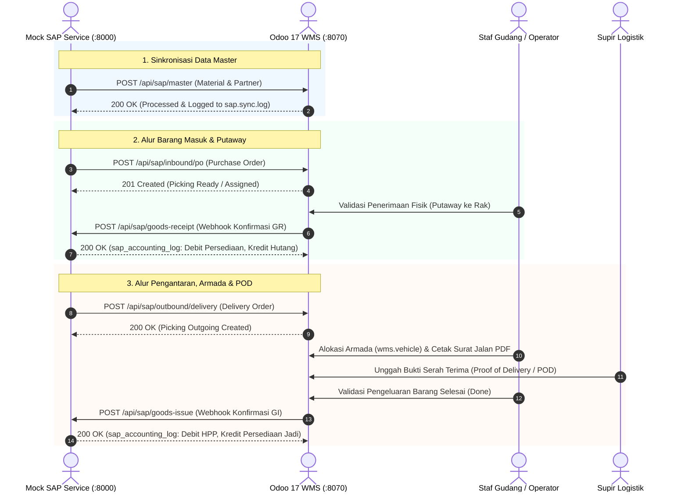

# Design Document: E2E Integration Validation

| Field              | Value                                         |
|--------------------|-----------------------------------------------|
| **Change Name**    | e2e-integration-validation                    |
| **Arch Pattern**   | Two-Tier Odoo WMS & SAP REST Connector        |
| **Primary Models** | `stock.picking`, `sap.sync.log`, `wms.vehicle`, `product.template`, `res.partner` |

## Context
Pada tahapan Fase 1 hingga Fase 5.1, seluruh model data, view, hak akses, kontroler REST API, mekanisme alokasi rak putaway, penerbitan Surat Jalan resmi, pencatatan bukti POD supir, pemicuan webhook dua arah, serta layanan simulator SAP (`mock_sap_server.py`) telah selesai dibangun dan divalidasi secara unit test terpisah.

Sesuai blueprint arsitektur [tsd.md](../../docs/tsd.md) Bagian 2.2, sistem Two-Tier ERP membutuhkan pembuktian integritas fungsional secara terpadu (*End-to-End Integration Validation*). Seluruh sub-sistem harus mampu berinteraksi secara mulus: transmisi master material dan partner dari SAP Upper Line, pembuatan dokumen pesanan penerimaan barang masuk (*Inbound PO*), otomatisasi penempatan kargo ke rak (*Putaway Rule*), pelaporan balik *Goods Receipt* ke SAP, pembuatan dokumen pengiriman kargo (*Outbound Delivery*), penugasan armada kendaraan logistik beserta supir, pencetakan Surat Jalan resmi, pengunggahan bukti serah terima (*Proof of Delivery / POD*), hingga konfirmasi akhir *Goods Issue* dan pemotongan HPP ke sistem akuntansi SAP.

## Goals / Non-Goals

### Goals
- Membangun suite pengujian integrasi otomatis komprehensif pada modul Odoo `addons/wms_sap_connector/tests/test_e2e_integration.py` berbasis Odoo `HttpCase` / `TransactionCase`.
- Membangun skrip verifikasi E2E mandiri `tests/verify_e2e_integration.py` yang mengeksekusi panggilan HTTP aktual antar-layanan kontainer Docker (`wms-odoo` pada port 8070/8069 dan `wms-mock-sap` pada port 8000).
- Memvalidasi konsistensi pencatatan transaksi audit log pada model `sap.sync.log` di setiap titik integrasi inbound dan outbound.
- Memverifikasi isolasi transaksi (non-blocking webhook) di mana kegagalan jaringan eksternal SAP tidak membatalkan atau merusak status fisik stok di gudang Odoo.
- Menjamin kepatuhan 100% pada linter `ruff check .` dan seluruh automated test suites (0 failures, 0 errors).

### Non-Goals
- Tidak mengubah skema data tabel inti ORM Odoo yang telah stabil pada fase-fase sebelumnya.
- Tidak mengimplementasikan pengujian visual browser berbasis Selenium/Playwright; pengujian berfokus pada kontrak API, ORM transitions, logika bisnis, dan serialisasi data.

## Decisions (ADR)

### 1. Dual-Layer E2E Testing Strategy (In-Engine HttpCase + Live Service CLI Runner)
- **Rationale:** Untuk menjamin kepastian kualitas tingkat enterprise, pengujian dilakukan pada dua lapisan:
  1. *In-Engine Odoo Test Suite* (`addons/wms_sap_connector/tests/test_e2e_integration.py`): Berjalan di dalam runtime engine Odoo untuk memvalidasi transisi status ORM, alur putaway, trigger webhook, dan logika isolasi error dalam transaksi database yang terkontrol.
  2. *Live Integration CLI Runner* (`tests/verify_e2e_integration.py`): Berjalan secara independen dari luar kontainer untuk menembakkan request HTTP nyata melintasi jaringan Docker bridge (`wms-network`), memverifikasi respon live dari endpoint Swagger/FastAPI dan Odoo REST API.
- **Alternatives Considered:**
  - Hanya mengandalkan live HTTP script: Tidak dapat memverifikasi state internal ORM Odoo atau record database secara mendalam jika terjadi kegagalan parsial.
  - Hanya mengandalkan internal Odoo tests: Tidak menguji integrasi jaringan kontainer Docker yang sebenarnya antara kontainer Odoo dan Mock SAP.
- **Consequences:** Memerlukan dua berkas pengujian terpisah, namun memberikan cakupan verifikasi 100% baik pada level kode internal maupun level arsitektur jaringan kontainer.

### 2. Dynamic Unique Identifier Generation for Repeatable Test Runs
- **Rationale:** Seluruh payload pengujian harus menggunakan nomor referensi unik berbasis timestamp (`PO-SAP-E2E-{timestamp}`, `SO-DELIV-E2E-{timestamp}`) agar pengujian E2E dapat dijalankan berulang kali secara idempoten tanpa terbentur batasan kunci unik dokumen.
- **Alternatives Considered:**
  - Menggunakan nomor dokumen hardcoded: Mengakibatkan kegagalan constraint duplikasi pada eksekusi pengujian kedua.
- **Consequences:** Pengujian mandiri dan bebas efek samping (*stateless & idempotent*).

## Technical Architecture & Data Schema

### 1. Alur Interaksi Dua Arah End-to-End



### 2. Struktur Skrip Pengujian Integrasi

```python
# Contoh struktur eksekusi skenario pada tests/verify_e2e_integration.py
def run_e2e_master_data_sync(session, odoo_url, token):
    """Memvalidasi push material dan partner dari SAP ke Odoo."""
    ...


def run_e2e_inbound_flow(session, odoo_url, sap_url, token):
    """Memvalidasi pembuatan PO, penerimaan kargo, dan webhook Goods Receipt."""
    ...


def run_e2e_outbound_flow(session, odoo_url, sap_url, token):
    """Memvalidasi pembuatan DO, penugasan armada, POD, dan webhook Goods Issue."""
    ...
```

## Risks & Trade-offs

| Risiko / Tantangan | Tingkat Keparahan | Strategi Mitigasi |
|---|---|---|
| Layanan Mock SAP belum aktif saat pengujian live E2E dijalankan | Medium | Skrip pengujian `verify_e2e_integration.py` melakukan pra-pemeriksaan (*pre-flight healthcheck*) ke `GET /health` Odoo dan Mock SAP sebelum memulai pengujian. |
| Perbedaan URL jaringan (Localhost vs Docker bridge `wms-network`) | Medium | Konfigurasi URL dapat disesuaikan melalui parameter CLI atau variabel lingkungan (`ODOO_URL`, `MOCK_SAP_URL`). |
| Kegagalan webhook eksternal mengganggu stok gudang | Low | Diuji secara eksplisit pada skenario edge case: validasi picking tetap berstatus `done` meskipun webhook SAP mengalami kegagalan/timeout. |
